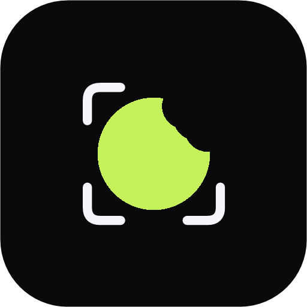
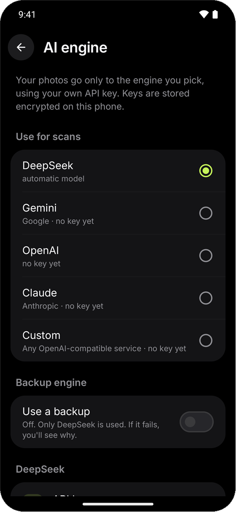

<p align="center">
  
</p>

<h1 align="center">Platebit</h1>

<p align="center">
  <b>Snap your meal. Know your calories.</b><br>
  A free, open-source Android calorie tracker that reads photos of your food with the AI you choose.
</p>

<p align="center">
  <a href="https://github.com/Joji228/Platebit/releases/latest/download/Platebit.apk"></a>
  &nbsp;
  <a href="LICENSE"></a>
</p>

<p align="center">
  
  
  
  
</p>

## What it does

- 📸 **Photo to calories.** Take a picture of your plate (or a nutrition label) and get calories, protein, carbs and fat. Adjust the grams (hold + or − to keep going) or the portion and it recalculates instantly.
- 📊 **One clean dashboard.** Calories, macros, water and a weight trend you can swipe through day by day; swipe past today to jump straight to the camera. Hold a meal to delete it, and pick one of 5 accent colors.
- 🧠 **Smart target.** After a couple of weeks it compares what you eat with how your weight moves and tunes your daily calories to your real metabolism.
- 🔑 **Bring your own AI.** Use DeepSeek, Gemini, OpenAI, Claude, or any OpenAI-compatible service, and set up to 4 side by side. You pay the provider directly; Platebit has no servers.
- 🔒 **Private by design.** No account, no ads, no tracking. Your meals stay on your phone, and photos go only to the AI you pick.

## Install

1. [Download the APK](https://github.com/Joji228/Platebit/releases/latest/download/Platebit.apk) on your phone and open it. Allow "Install unknown apps" if Android asks.
2. Open **Settings → AI engine** and paste an API key for the service you want to use.
3. Tap the camera and scan a meal.

Needs Android 12 or newer. Calorie and body figures are estimates, not medical advice.

## Optional: Xiaomi smart scale

New in 1.0. If you have a **Xiaomi Mi Body Composition Scale 2** (model **XMTZC05HM**), turn on **Settings → Smart scale** and Platebit reads it directly:

- ⚖️ **Weigh in** from the Weight card. Step on the scale barefoot and Platebit picks up your weight and body impedance over Bluetooth. There's nothing to pair, no Xiaomi account, and Zepp Life keeps working.
- 🧍 **Body screen.** Tap the Weight card for a body score, BMI, and estimates of body fat, muscle, water, bone, visceral fat, BMR and body age, with trends over time.

It's off by default, and other scale models aren't supported. Body composition is estimated from published formulas: good for following trends, not a medical measurement.

## Build from source

```bash
git clone https://github.com/Joji228/Platebit.git
cd Platebit
./gradlew assembleDebug     # needs JDK 17+ and the Android SDK
```

Kotlin, Jetpack Compose, Room, CameraX. The debug APK lands in `app/build/outputs/apk/debug/`.

## License

[MIT](LICENSE). The [Inter](https://rsms.me/inter/) font is used under the [SIL Open Font License](licenses/Inter-OFL.txt).
